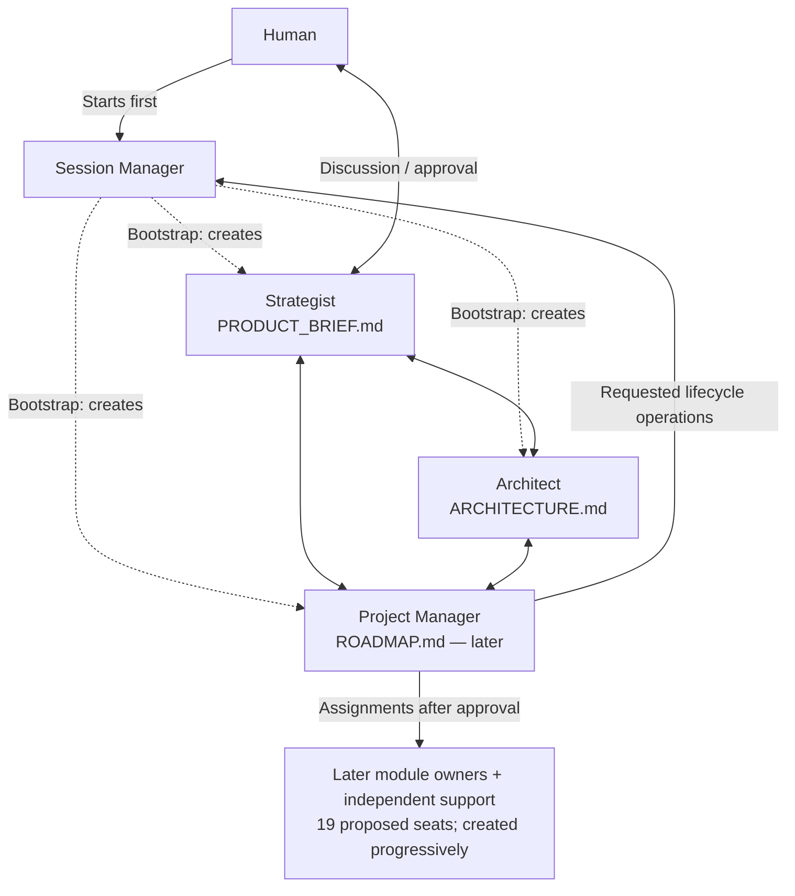

# gridpico

**A portable MIDI workstation kernel: routing and transformations now, a preserved path to sequencing later. No synthesis or audio engine.**

Gridpico connects existing instruments through interchangeable controllers and platform backends. RP2040 is the compact hardware deployment; Linux x86, Linux ARM (including Raspberry Pi Zero) and Windows run the same musical application through their own services.

This repository starts with design documents, diagrams and development tooling. It does **not** contain product firmware, a working simulator or an implementation roadmap.

## Start here

| Document | Owner | Purpose |
| --- | --- | --- |
| [Product brief](PRODUCT_BRIEF.md) | Strategist | Product intent, scope and business case |
| [Architecture](ARCHITECTURE.md) | Architect | Modules, connections, portability and future sequencer boundary |
| [Agent coordination](AGENT_TEAM_COORDINATION.md) | Human authority; Strategist records approved changes | Initial team, responsibilities, communication and session operations |
| [Container and first-run setup](docs/SETUP.md) | Application Assembly when created | Development environment, shared credentials and planning-team startup |
| [Diagrams](docs/diagrams/README.md) | Respective document owners | Visual module/team maps and editable Mermaid sources |

**`ROADMAP.md` is deliberately absent.** Project Manager creates it after discussing the product and architecture with Strategist and Architect.

## Initial team

The human starts **Session Manager**, which creates **Strategist, Architect and Project Manager**. No other agent is created until the human approves expansion and Project Manager requests it. The proposed full team has 23 seats, created progressively rather than all at once.

Session Manager keeps the approved list and original Codex session IDs and performs requested create/start/pause/resume operations. It is not an enforcer or supervisor. Resumption uses the exact original session, with no checkpoint/reconstruction workflow.



[Open the complete team and architecture diagrams](docs/diagrams/README.md).

In the complete team diagram, grouped frames contain multiple agents; each numbered card is one agent. Lead badges are extra duties, not extra seats. The [coordination agreement](AGENT_TEAM_COORDINATION.md) governs operational details and the initial bootstrap exception.

## Development container

Use a **new gridpico container and checkout** on the same Docker daemon as the existing rpico-bridge environment. The provided recipe is adapted from that environment, while reusing these exact external named volumes:

- `pico-dev-codex` → `/home/pico/.codex`
- `pico-dev-gh` → `/home/pico/.config/gh`

No credentials are copied into this repository or image. The mounted Codex directory also contains existing configuration and session history; the setup does not overwrite it. Herdr runtime state uses a separate `gridpico-herdr` volume.

From this directory:

```sh
docker compose -f .devcontainer/compose.yaml up -d --build
docker compose -f .devcontainer/compose.yaml exec dev bash
```

VS Code's **Reopen in Container** uses the same Compose definition. See [setup](docs/SETUP.md) for authentication checks and the first Session Manager prompt. No setup command automatically launches agents.

## Get the source

```sh
git clone https://github.com/NevynIt/gridpico.git
cd gridpico
```

Use a separate checkout and the same Docker daemon as rpico-bridge. The container commands above are run from this checkout on the Docker host. No additional repository-creation script is needed.

## Scope and provenance

APC is the preferred interface, not the identity of the kernel. Its web simulator exercises the production APC frontend; CLI and future piano controls use the same musical commands. RP2040 includes a read-only USB drive for static HTML/documentation. Desktop deployments do not emulate a USB disk or CDC when they do not need them.

Earlier projects are design references and experiments only. No product code is imported. The development-tooling attribution is in [Sources](docs/SOURCES.md) and the corresponding [notice](third_party/notices/rpico-bridge-MIT.txt). The repository uses the [MIT license](LICENSE) selected when the human created it.
