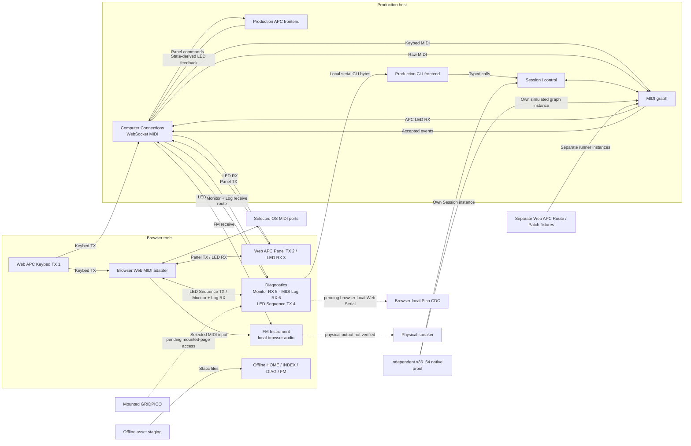

# Gridpico at a glance

Gridpico routes and transforms MIDI through one production graph. This map shows the current Web APC controller and Diagnostics paths, plus the independent native proof. The proof and Route/Patch fixtures use separate runtime instances of shared Session/Graph code. Dashed edges mark target hardware paths still pending. See the [owner-supplied hardware topology](HARDWARE.md).

The default `./scripts/web-ui.sh` profile tries Keybed TX 1, Panel TX 2 and APC LED RX 3 once. Diagnostics separately tries Monitor RX 5 and MIDI Log RX 6 once. Each managed route becomes active when the Web APC keybed and that route’s receiving port are connected. To send LEDs, bind LED Sequence TX 4 and explicitly enable the Raw route. Browser Web MIDI connects directly to a selected OS port and can work without the Node host. Monitor audio needs a user gesture.

## Maturity and evidence

| Status | Evidence |
| --- | --- |
| **Verified · Linux and Chromium** | The x86_64 native route/transpose proof configures Session and injects simulated notes into the graph. The published Web APC Route/Patch gates, canonical launcher, Diagnostics CLI help and LED replay, Linux ALSA Web MIDI, FM and offline browser tools have independent evidence. See [native proof at pinned revision](https://github.com/NevynIt/gridpico/blob/f8b15cd0f43c519f3b27296d7c24677e49fbffe4/ROADMAP.md#independent-native-proof), [current browser startup](../api/browser-midi.md#production-startup-and-page-roles), [Web APC gates](../api/patchbay-controls.md#independent-fast-play-gate), [router](../api/local-router.md#production-graph), [Routing tool](../api/routing.md#separate-routing-tool), and [instrument / offline demo evidence at pinned revision](https://github.com/NevynIt/gridpico/blob/f8b15cd0f43c519f3b27296d7c24677e49fbffe4/ROADMAP.md#approved-tonight-delivery). |
| **Verified · Linux hosts and instruments** | Native two-host WSS and bounded Linux RTP delivery with scoped cleanup passed; RTP repeatability and loss recovery remain open. Pi-local arm64 routing, stock FluidSynth WAV capture and standalone browser FM were verified. Installed Pico firmware passed startup, USB CDC and BOOTSEL recovery. Jill demonstrated the selected physical APC-to-MicroFreak route. Earlier RAM-only Chrome/WSS C4 and Pad 00 checks remain separate [bench evidence at pinned revision](https://github.com/NevynIt/gridpico/blob/f8b15cd0f43c519f3b27296d7c24677e49fbffe4/ROADMAP.md#approved-physical-pico-and-cdc-delivery). See [host evidence at pinned revision](https://github.com/NevynIt/gridpico/blob/f8b15cd0f43c519f3b27296d7c24677e49fbffe4/ROADMAP.md#4-verify-rtp-midi-and-productize-cross-host-websocket-midi), [Pi and instrument evidence at pinned revision](https://github.com/NevynIt/gridpico/blob/f8b15cd0f43c519f3b27296d7c24677e49fbffe4/ROADMAP.md#approved-tonight-delivery), [current Pico acceptance](../ROADMAP.md#current-product-status), [physical Pico acceptance](../ROADMAP.md#approved-physical-pico-and-cdc-delivery), [installed firmware](../api/pico-target.md#installed-patchbay-matrix), [standalone firmware route](../api/pico-target.md#standalone-firmware-route), [live Pico Diagnostics](../platform/linux/PI_ROUTER.md#pico-console-from-diagnostics), [Monitor controls](../api/web-monitor-proposal.md#local-listening-controls), and [Monitor evidence at pinned revision](https://github.com/NevynIt/gridpico/blob/f8b15cd0f43c519f3b27296d7c24677e49fbffe4/ROADMAP.md#web-apc-rapid-play-regression-and-next-monitor-update). |
| **Pending · targets and portability** | Independent full Patchbay editing/audition, audible output, visible LED confirmation, mounted `GRIDPICO`, direct browser Web Serial and deployed browser-to-Pico MIDI remain open. Windows/WSL, desktop-browser mTLS from an operator laptop, reliable RTP timing/rebind, Keybed export `/midi/5`, and broader device qualification including P-95/MiniFuse also remain open. Projects, sequencing and broader portability remain planned. See [current acceptance](../ROADMAP.md#current-product-status) and [bench topology](HARDWARE.md). |
