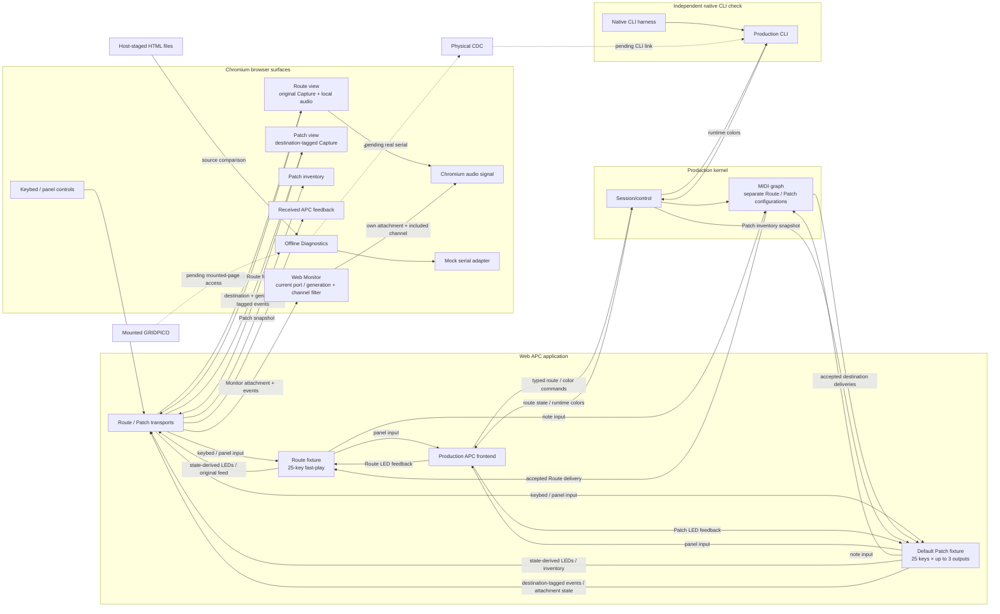

# Gridpico at a glance

Gridpico routes and transforms MIDI between existing instruments. Dashed links mark mounted-drive and physical CDC paths that remain pending. See the [planned hardware topology](HARDWARE.md).

Route keeps its original accepted-event feed for Capture and local audio. Default Patch Capture lists accepted destinations. Web Monitor plays only its current attachment and included channel. Chromium audio signal measurements do not establish physical speaker output.

## Maturity and evidence

| Status | Scope and evidence |
| --- | --- |
| **Verified · fast play** | Published Route gate `7d8889a` and Patch gate `299ec25`. The two-output profile now runs via `--two-branch`, with 25 keys, untagged Capture and silent browser audio. Default Patch with Monitor supports 25 keys × up to 3 outputs. See [gate evidence](../ROADMAP.md#web-apc-rapid-play-regression-and-next-monitor-update) and [connections startup](../connections/README.md). |
| **Verified · Web Monitor** | Independent Chromium measured a 523 Hz held Monitor tone continuing after instrument Note Off. The selector defaults to All channels and offers MIDI 1–16. Patch Capture shows accepted events from all destinations. Stale-generation Note Offs leave current voices sounding. With 25 notes held across three active destinations, the runner drained 75 releases on connection loss. This confirms browser audio signal, not physical speaker output. See [Monitor evidence](../ROADMAP.md#web-apc-rapid-play-regression-and-next-monitor-update). |
| **Verified offline · target pending** | APC↔CLI runtime colors and offline Diagnostics with mocked serial are verified. Host-staged `INDEX.HTM` and `DIAG.HTM` matched their sources byte for byte. Mounted `GRIDPICO` and physical CDC remain pending. Projects, sequencing, OS MIDI and portable Windows/Linux ARM/RP2040 coverage remain planned. See [offline evidence](../ROADMAP.md#next-approved-product-work-after-web-apc-protocol-and-timed-leds). |
