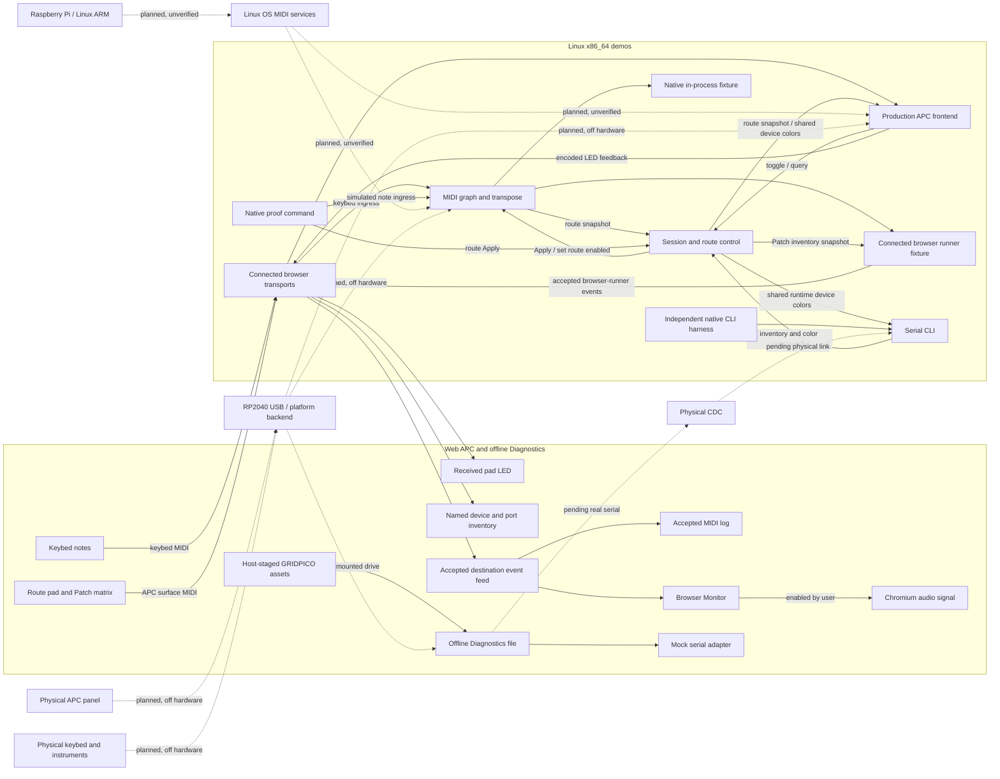

# Gridpico at a glance

Gridpico routes and transforms MIDI between existing instruments. The diagram shows the verified x86_64 and connected browser slice. Dashed links mark paths that still need target or hardware verification.

See the [planned hardware topology and evidence boundary](HARDWARE.md).

Native proof and browser demos use the production Session/control and MIDI graph with separate fixtures. Browser Patch adds fan-out and named inventory. Diagnostics opens offline with a mocked serial adapter. The live destination feed serves both Capture and Monitor. Chromium measured browser audio signal, not physical speaker output.

## Maturity and evidence

| Status | Scope and evidence |
| --- | --- |
| **Verified** | Native route/Patch fixtures and connected Web APC Patch fan-out and inventory. APC↔CLI runtime colors and CLI→Session were verified in the native harness. Capture omits destination IDs, so matching branch notes look alike and share one Monitor voice. Native tests verify destination identity. Chromium opened Diagnostics directly offline with mocked serial. Staged assets matched source byte for byte. The browser mock does not invoke production CLI. See [verified work and limits](../ROADMAP.md#next-approved-product-work-after-web-apc-protocol-and-timed-leds), [native Patch fixture](../api/patchbay.md#stage-one-native-patch-fixture), and [CLI](../frontends/cli/README.md). |
| **Bounded partial implementation** | These demos cover a small route slice, not a complete workstation or target capacities. See the [proof contract](../api/README.md#linux-x86_64-route-and-transpose-proof) for the scope. |
| **Planned / off hardware** | Projects, sequencing, Windows and Linux OS MIDI. Mounted read-only `GRIDPICO` and real Diagnostics→CDC→CLI remain pending, as do physical CDC, Linux ARM / Raspberry Pi and RP2040 USB/device tests. The Linux x86_64 fixtures are not OS MIDI or hardware tests. |

**Evidence rule:** Tie each status to a reproducible command or recorded independent verification. When verified scope changes during normal work, update this page with the evidence link and exact boundary. Keep simulated, browser, OS and physical-hardware results distinct.
