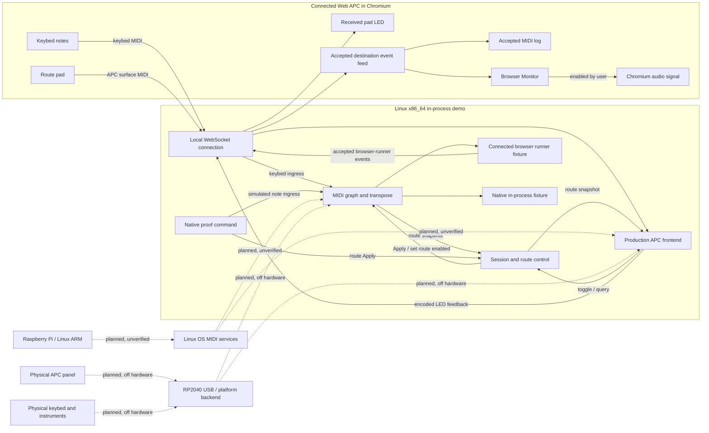

# Gridpico at a glance

Gridpico routes and transforms MIDI between existing instruments. The diagram shows the verified x86_64 and connected browser slice. Dashed links mark paths that still need target or hardware verification.

The native proof and connected browser demo use the same production Session/control, MIDI graph and transpose code with separate in-process fixtures. Native proof applies the route through Session/control and injects simulated notes into the graph. It does not use Linux OS MIDI services. In the connected demo, browser keybed notes reach the runner over WebSocket. Only that runner returns destination-accepted events over the connection. One live destination-event feed branches to the browser log and Monitor as separate consumers. When the route is disabled with a note held, the accepted Note Off reaches the browser before the dark LED feedback. Monitor audio is generated in Chromium after the user enables it. The evidence confirms a browser audio signal, not sound from a physical speaker.

## Maturity and evidence

| Status | Scope and evidence |
| --- | --- |
| **Verified** | In-process route/transpose proof in Linux x86_64 plus connected Web APC keybed, production Route pad, accepted MIDI log, LED feedback and Monitor. Reproduce with the [native command](../scripts/demo-route-transpose.sh) and [connected demo](../connections/README.md). See [native](../api/README.md#linux-x86_64-route-and-transpose-proof), [browser](../ROADMAP.md#verified-demo-path), [route pad and Monitor](../ROADMAP.md#approved-follow-ons-for-the-rest-of-tonight), and [responsive APC layout and feedback-driven status](../ROADMAP.md#verified-web-apc-layout-upgrade). Chromium measured the live channel-1 browser audio signal. Local browser checks covered all 16 channel controls and same-pitch isolation. Independent Chromium verified the responsive APC layout and status from received LED feedback at desktop and narrow widths. This does not verify physical speaker output. |
| **Bounded partial implementation** | These demos cover a small route slice, not a complete workstation or target capacities. See the [proof contract](../api/README.md#linux-x86_64-route-and-transpose-proof) for the scope. |
| **Planned / off hardware** | Projects, sequencing, CLI, Windows, Linux OS MIDI, Linux ARM / Raspberry Pi, RP2040 USB and physical APC, keybed and instruments. These need implementation and/or target or bench evidence. The native proof does not test Linux OS MIDI or physical Pi/USB. |

**Evidence rule:** Tie each status to a reproducible command or recorded independent verification. When verified scope changes during normal work, update this page with the evidence link and exact boundary. Keep simulated, browser, OS and physical-hardware results distinct.
