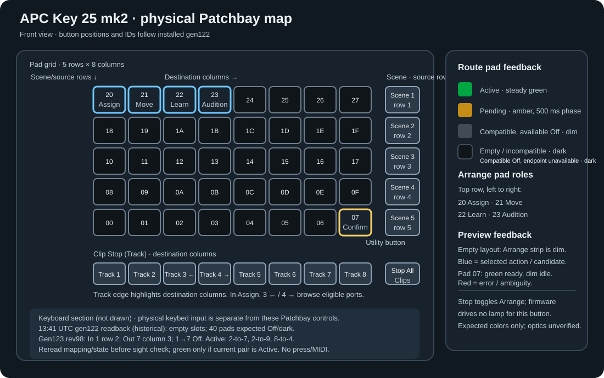

# Pico bench quick reference

Use [hardware wiring](HARDWARE.md) for the bench topology, the [Pico target contract](../api/pico-target.md) for recovery and target limits, and the [Roadmap](../ROADMAP.md#current-product-status) for current acceptance.

Jill authorizes repeated firmware flashes on the identified **DEV Pico only**, including occupied old-firmware sectors within the image’s erase range. Sector-by-sector approval and preservation of old flash contents are unnecessary. Keep a verified board-compatible firmware image for BOOTSEL recovery. Follow the [Pico flash verification procedure](../api/pico-target.md#recovery-and-release) and the [existing Pi and recorder maintenance protections](../platform/linux/PI_ROUTER.md#clear-development-connections-for-maintenance).

## Current bench build

The DEV Pico baseline is retained image `56c65dff` at USB generation 122: `Gridpico RP2040 Router`, `1209:0001`, `bcdDevice 0104`, upstream path `1-1`. The UF2 SHA-256 is `56c65dff8946746798e3bc1123c9b85b93e94462241990a7b72d663e2c9cbcbd`; the retained full-flash readback SHA-256 is `034a6741209b74a64b78ad769bfc1673c30fa44d7e6ab290786f17cc330a7868`. A 13:41 UTC read-only check confirmed live USB generation 122. It did not reread flash. Startup and same-board BOOTSEL/no-write return passed. [Current acceptance](../ROADMAP.md#current-product-status) · [Pico target and recovery](../api/pico-target.md#recovery-and-release).

## Pico Diagnostics

On the private LAN, open [Pi Diagnostics](http://192.168.0.223:18768/diagnostics/), select **Pico via Pi · LAN WebSocket CDC**, and click **Connect**. Click **Check Pico commands** before using the listed readback commands such as `help`, `inventory`, `status`, `TRACE` and `HUBTRACE`. See the [operator steps](../platform/linux/PI_ROUTER.md#pico-console-from-diagnostics), [CDC contract](../api/pico-target.md#private-lan-pico-cdc) and [typed CLI contract](../api/pico-target.md#first-shared-cli-on-pico-and-pi).

Pi route control is separate. Open `http://127.0.0.1:18767/diagnostics/` through the approved strict SSH forward and select **Loopback CLI** to inspect or change Pi routes. Those commands do not edit the Pico Patchbay. Pico route editing is not yet accepted.

> **Physical Pico vs. Web APC:** This Arrange map is for the physical APC Panel/LED connection owned by the Pico. Web APC in M5 connects to the portable router, and Pi Web APC connects to the Pi router. A browser **Stop All Clips** click is handled by its selected router and does not toggle Arrange on the Pico. Pi Diagnostics can relay Pico CDC serial CLI commands and readback. It is not a musical MIDI or APC Panel/LED bridge. The current deployment has no verified browser-to-Pico controller link. See [browser page roles](../api/browser-midi.md#production-startup-and-page-roles), [Pi Pico Diagnostics](../platform/linux/PI_ROUTER.md#pico-console-from-diagnostics), and the [Pico’s physical route boundary](../api/pico-target.md#standalone-firmware-route).

## Patchbay quick start

The drawing shows the APC Key 25 mk2 from the front. The numbered pads and edge buttons match the current [APC firmware mapping](../frontends/apc/apc_physical.c). Hardware names and button IDs follow the [Akai APC Key 25 mk2 protocol](https://cdn.inmusicbrands.com/akai/attachments/APC%20Key%2025%20mk2%20-%20Communication%20Protocol%20-%20v1.1.pdf). [Open the controller map](images/pico-apc-patchbay.svg).

The 13:41 UTC gen122 read-only receipt reports APC revision 14 with Panel input 12 bound and LED output 13 reserved. All five source and eight destination placement slots are empty (`-`). Routing/Auto revision 5 has six Active Auto routes, zero Pending, out of 25 candidates. The six Active routes are unplaced, so they have no crosspoint on this page. With normal Patchbay and this empty layout, the expected projection is all 40 route pads Off/dark. This is specific to empty placement, not a general choice to keep route LEDs dark. Jill reports that the main pads are dark and that **Stop All Clips** responds. The read-only receipt did not exercise any APC press or gesture. It provides no delivery or optical proof and captured no fresh LED transfer.

**Enter or leave Arrange.** Give the separate **Stop All Clips** utility button at the lower-right of the pad/control area a fresh press. It toggles Arrange on or off. This control has no LED, so use the mode you selected as the state. Exiting clears an uncommitted preview, stops Audition, and refreshes Patch. It keeps committed edits. In Arrange, the four top-left grid pads select **Assign**, **Move**, **Learn** and **Audition**. Pad `07` at the grid’s bottom-right confirms a valid preview.

**Place a source or destination.** In Arrange, press **Assign**. Choose a **Scene Launch** button on the right edge to select a source row, or a **Track** button below the grid to select a destination column. After choosing the slot, use Track buttons 3 and 4 as previous/next to browse eligible ports. The preview strip follows the current eligible-port order. Confirm the highlighted candidate with Pad `07`. Or choose **Learn**, select a Scene row, send one attack from the intended MIDI input, then press Pad `07`. Learn selects a source only. A destination still needs Assign. Layout edits are volatile and there is no Save operation.

**First route view without changing Graph.** On the captured gen122 inventory order, place **USB MIDI Interface In** (port `1`, candidate pad `0A`) on Scene row 1 and **Arturia MicroFreak Out** (port `7`, candidate pad `0D`) on Track column 1. Confirm each with Pad `07`. This pair was already Active at Routing revision 5. Leave Arrange. The top-left crosspoint, pad `20`, should represent that Active route. Do not press it for this view check. A fresh press would turn the route Off. The candidate pad numbers are specific to this receipt’s device order. Recheck `inventory` after attachments change. This is predicted from the exact installed source and readback. The gen122 health session did not exercise placement or route presses.

**Toggle a route.** A fresh press on a visible compatible Active crosspoint requests Off; a press on a compatible Off crosspoint requests On. Confirm the pair’s names, directions, and current state before pressing. Dark alone does not mean Off. Unassigned or incompatible cells are also dark. This gen122 receipt does not identify a safe extra route to enable without consuming reserved branch capacity or selecting a pair excluded for topology reasons. The current live acceptance for physical edits and visible route feedback remains open in the [Roadmap](../ROADMAP.md#current-product-status).

**Move or audition.** Move starts from an occupied row or column. Select **Move**, choose its edge button, choose another slot on the same edge, then confirm with Pad `07`. An occupied destination swaps placements while preserving route IDs. With the current empty layout there is no Move origin. Audition requires an assigned connected output: tap the **Audition** action pad, choose its Track button, then make a fresh press-and-hold on the **Audition** pad to start one bounded phrase. Release it to stop. Confirm does not start Audition. The current empty layout has no Audition destination. These gestures are source/offline-backed; the current health session exercised none, and live physical Audition remains unverified.

The route colors in the drawing are firmware output meanings: green is Active, alternating amber is enabled Pending, dim is routable Off, and dark is empty or incompatible. Their physical appearance on this current image has not been independently checked.
