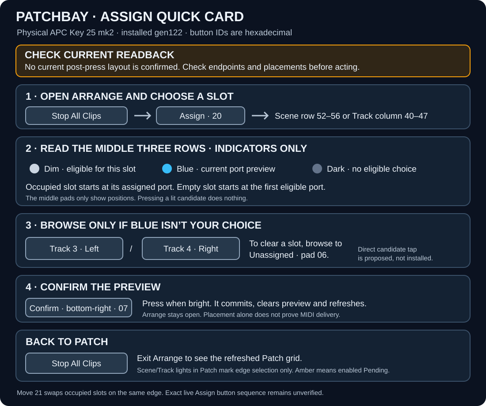

# Pico bench quick reference

## Physical APC Patchbay · quick card

[Full APC button map](images/pico-apc-patchbay.svg) · [Current Patchbay contract](../api/routing.md#editable-physical-apc-patchbay)

### Longer operator reference

**Before editing.** Use the Pico CLI's current route and placement readback. Continue only when the intended source and destination have available slots and the candidate matches that readback. If the layout or preview is unclear, stop without confirming. See the [Pico CLI contract](../api/pico-target.md#first-shared-cli-on-pico-and-pi).

**Sight check · readback first, no action.** The supplied gen123 Routing revision 98 readback placed USB MIDI Interface In (`1`) at row 2 and Arturia MicroFreak Out (`7`) at column 3. The `1`→`7` pair was Off; the three enabled routes were `2`→`7`, `2`→`9` and `8`→`4`. Read current placements and route state before any later sight check. Call the mapped intersection green only if that exact pair reads Active in the current state. Do not press a pad or send MIDI for this check. The gen122 `1`→`7` Active view below is historical, not current. Generic placement-only Assign instructions are separate.

**Current Assign controls · source-reviewed.** Stop All Clips (`51`) opens Arrange. Press Assign (`20`), then choose a Scene row or Track column. Read the middle three rows: dim = eligible, blue = current preview, dark = no eligible choice. An occupied slot starts at its assigned port; an empty slot starts at the first eligible port. If blue is already right, go to Confirm. Otherwise use Track 3 (`42`, left) or Track 4 (`43`, right) only as needed. Browse to Unassigned with Track 3/4. Pad 06 lights blue to show that preview. Press 07 to clear the selected slot. Press bottom-right Confirm (`07`) when bright. Success clears the preview, refreshes the committed layout, and leaves Arrange open. The exact live operator sequence remains unverified. Directly tapping a lit candidate is proposed only and is not installed firmware behavior.

**Learn · separate action.** Learn (`22`) selects a Scene source row; one distinct attack identifies an input for placement. That attack may pass through existing live routes. Learn is not part of the dated 1→7 placement-only reveal.

### Four Arrange actions

- **Assign (`20`)** places an eligible port in one row or column. Empty slots preview the first eligible port; occupied slots start on their current port. The middle candidate pads are indicators only: pressing one does nothing. Firmware `arrange_press` handles Track 3 (`42`, left) / Track 4 (`43`, right) browsing and the bottom-right Confirm (`07`). The direct-tap idea in [USE_CASES.md](../USE_CASES.md) is proposed, not current firmware behavior. The strip shows positions, not port names: dim = eligible, blue = selected, dark = no eligible choice. Browse to Unassigned with Track 3/4. Pad 06 lights blue to show that preview. Press 07 to clear the selected slot. Confirm commits and stays in Arrange.
- **Move (`21`)** moves an occupied slot along the same edge. An occupied target swaps. The 13:41 UTC gen122 readback had empty placement slots; Jill later rebuilt the matrix. After Jill freed CDC, Strategist obtained a read-only gen123 Routing revision 98 result with 3 Active / 0 Pending, then closed normally. Exact live Assign presses, LED optics, and saved restoration remain unverified. Use a fresh current placement readback for a Move origin; none is inferred from the dated empty layout.
- **Learn (`22`)** selects a Scene row, then learns one source from its next attack. The next attack may pass through an already-Active route. Multiple sources make the preview ambiguous; do not confirm it.
- **Audition (`23`)** needs an assigned, connected output column. Tap and release `23`, choose Track, then make a fresh hold on `23`; release or press Stop All Clips (`51`) to end the phrase. If no connected output is assigned, Audition is unavailable. The physical gesture remains unverified.

### Mode, cues, and safe stops

- A route crosspoint works only in normal Patch mode, with both its source row and destination column assigned. Scene / Track presses in Patch only highlight an edge; they are optional. Pad `20` is Assign in Arrange and the row 1 × column 1 crosspoint in Patch.
- Before a press, compatible Off with both endpoints available is **dim**; empty, incompatible, or unavailable Off is **dark**. A compatible Off can request On even while dark if an endpoint is unavailable. Wait for the committed page refresh. A successful enable is steady green when Active; enabled Pending alternates amber (500 ms). A fresh press on Active or Pending requests Off. A refused edit retains the committed state, so Off remains Off. This guide prescribes no new route for the current rig.
- In Arrange, action pads start dim even on an empty layout. **Blue** marks the selected action or candidate. Confirm `07` is green when ready, dim when idle, and red on error or ambiguity. Stop All Clips has no firmware-driven lamp.
- Candidate pads show positions, not port names. Dim candidates are eligible, blue is the current preview, and dark means no eligible choice. Track 3 (`42`, left) and Track 4 (`43`, right) browse only if needed, without Shift. Browse to Unassigned with Track 3/4. Pad 06 lights blue to show that preview. Press 07 to clear the selected slot. If the blue candidate does not match the readback, or Confirm is not green, do not confirm. Stop All Clips cancels an uncommitted preview; committed placements remain.
- After exiting Arrange, wait for the complete current Patch page before any route press. A stale page repaints without editing. Green is expected firmware output; physical optical confirmation remains open.

### Historical readback · 13:41 UTC · placement slots were empty

The 13:41 UTC gen122 readback is historical, not the post-press layout. Its Routing revision 5 recorded **USB MIDI Interface In (`1`) → Arturia MicroFreak Out (`7`) Active**. This is a dated view-only example: inspect only after a current readback confirms the same endpoints and Active state, and never tap it as part of the check. The snapshot also recorded six Active Auto routes, zero Pending, and all five source / eight destination placements empty. APC revision 14 had Panel input 12 bound and LED output 13 reserved. HAL's receipt was read-only and captured no fresh LED transfer. Jill separately reports that Stop All Clips responds and the main pads appear dark. Neither source provides controlled LED optics or audible-output proof. The sealed source predates published Audition follow-ups. [Current acceptance](../ROADMAP.md#current-product-status) · [Pico target and recovery](../api/pico-target.md#recovery-and-release).

**Operator reports · J012 guidance, J017/J020 actions.** J012 was guidance. Jill reports that after reboot she manually recreated the matrix, allocated outputs to columns, and enabled some routes. This partial-success report is separate from HAL's dated read-only 13:41 receipt. No exact Track/output, browse or Confirm sequence, resulting pad color, or successful reassignment was recorded. Saved restoration remains unverified. Jill later freed CDC. Strategist then obtained a read-only gen123 Routing revision 98 result (3 Active / 0 Pending) and closed normally. That snapshot recorded the placements at the time, but did not capture the exact live Assign presses.

## Bench reference

Use [hardware wiring](HARDWARE.md) for the bench topology and the [Pico target contract](../api/pico-target.md) for recovery and target limits. Jill authorizes repeated firmware flashes on the identified **DEV Pico only**, including occupied old-firmware sectors within the image erase range. Sector-by-sector approval and preservation of old flash contents are unnecessary. Keep a verified board-compatible BOOTSEL recovery image. Follow the [flash verification procedure](../api/pico-target.md#recovery-and-release) and [Pi / recorder maintenance protections](../platform/linux/PI_ROUTER.md#clear-development-connections-for-maintenance).

The newly approved boot policy is follow-on work; it is not installed behavior.

The last recorded DEV Pico image check identified `56c65dff`, USB `1209:0001`, `bcdDevice 0104`, path `1-1`. Its full-flash readback SHA-256 was `034a6741209b74a64b78ad769bfc1673c30fa44d7e6ab290786f17cc330a7868`. The 13:41 UTC USB-generation check was read-only and did not reread flash. Startup and same-board BOOTSEL/no-write return passed.

On the private LAN, open [Pi Diagnostics](http://192.168.0.223:18768/diagnostics/), select **Pico via Pi · LAN WebSocket CDC**, and click **Connect**. Click **Check Pico commands** before using the listed readback commands such as `help`, `inventory`, `status`, `TRACE` and `HUBTRACE`. See the [operator steps](../platform/linux/PI_ROUTER.md#pico-console-from-diagnostics), [CDC contract](../api/pico-target.md#private-lan-pico-cdc) and [typed CLI contract](../api/pico-target.md#first-shared-cli-on-pico-and-pi).

Pi route control is separate. Open `http://127.0.0.1:18767/diagnostics/` through the approved strict SSH forward and choose **Loopback CLI**. Those commands inspect or change Pi routes, not the Pico Patchbay. Pi Diagnostics can relay Pico CDC commands but is not a musical MIDI or APC Panel / LED bridge. M5 Web APC connects to the portable router; Pi Web APC connects to the Pi router. There is no verified browser-to-Pico controller link. [Browser roles](../api/browser-midi.md#production-startup-and-page-roles) · [Pico route boundary](../api/pico-target.md#standalone-firmware-route).
