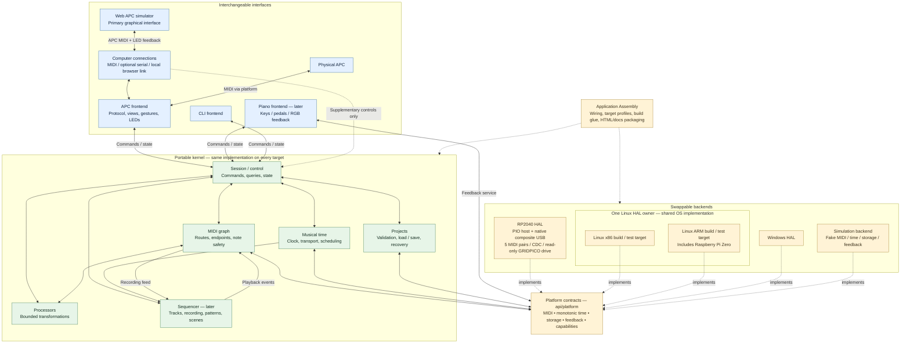

# gridpico diagrams

## Musical architecture

**Two important distinctions:** the Web APC simulator passes through the production APC frontend, not directly into an independent browser control engine; Linux x86 and ARM are separate build/test targets sharing one Linux HAL owner/implementation family. Application Assembly and Computer connections are explicit modules.

Arrows describe interaction/dependency boundaries, not a requirement for threads, processes or dynamic loading. The kernel is one portable implementation. These are software modules; agent ownership is shown in the second diagram.

[Editable architecture source](architecture.mmd) · [Architecture specification](../../ARCHITECTURE.md)

## Agent team

One numbered card is one agent; grouped frames contain several agents. A Lead badge is an additional duty, not an extra seat. The human starts Session Manager first, which bootstraps Strategist, Architect and Project Manager. The other 19 seats are proposed and created progressively only after approval and Project Manager requests.

Session Manager keeps the list and operates sessions; it does not enforce approval or resource policies. Approval remains a human/Strategist/Project Manager responsibility. The three planning agents collaborate, while Strategist owns the brief, Architect the architecture and Project Manager the roadmap. The roadmap is not supplied in this starter.

Only Strategist initiates human-facing communication; the human may still ask any agent a brief direct question. The coordination agreement governs operational details. Invisible links in the source only arrange the roster vertically; they do not add reporting relationships.

```mermaid
flowchart TB
  human["Human<br/>Product direction + approval"]
  subgraph initial["Initial team — exactly 4 agents"]
    sm["04 · SESSION MANAGER<br/>Approved list + exact Codex session IDs<br/>Create / start / pause / resume<br/>No enforcement or scheduling"]
    st["01 · STRATEGIST<br/>Human gateway<br/>Owns PRODUCT_BRIEF.md"]
    ar["02 · ARCHITECT<br/>Owns ARCHITECTURE.md + api/<br/>Public contracts, not implementations"]
    pm["03 · PROJECT MANAGER<br/>Owns ROADMAP.md — created after discussion<br/>Assignments, acceptance, commits"]
  end
  human -->|"Starts first"| sm
  sm -.->|"Bootstrap: creates"| st
  sm -.->|"Bootstrap: creates"| ar
  sm -.->|"Bootstrap: creates"| pm
  human <-->|"Discussion + approvals"| st
  st <--> ar
  st <--> pm
  ar <--> pm
  pm -->|"Lifecycle requests after bootstrap"| sm
  sm -->|"Actual status / errors"| pm
  gate["Human approval through Strategist<br/>Before any additional agents are created<br/>PM requests progressive creation; SM executes"]
  st --> gate
  gate -.-> pm
  subgraph later["Proposed later team — 19 individual seats, not all started at once"]
    subgraph kernel["KERNEL · 6 agents — Architect guides directly"]
      k1["05 · Session / control"]
      k2["06 · MIDI graph"]
      k3["07 · Processors"]
      k4["08 · Musical time"]
      k5["09 · Sequencer — later"]
      k6["10 · Projects"]
      k1 ~~~ k2 ~~~ k3 ~~~ k4 ~~~ k5 ~~~ k6
    end
    subgraph interfaces["INTERFACES · 5 agents"]
      i1["11 · APC frontend<br/>Also Interfaces Lead"]
      i2["12 · Piano frontend — later"]
      i3["13 · CLI frontend"]
      i4["14 · Web APC simulator"]
      i5["15 · Computer connections"]
      i1 ~~~ i2 ~~~ i3 ~~~ i4 ~~~ i5
    end
    subgraph platforms["PLATFORMS · 5 agents"]
      p1["16 · Application Assembly<br/>Also Platforms Lead"]
      p2["17 · RP2040 HAL"]
      p3["18 · Linux HAL<br/>x86 + ARM target profiles"]
      p4["19 · Windows HAL"]
      p5["20 · Simulation backend"]
      p1 ~~~ p2 ~~~ p3 ~~~ p4 ~~~ p5
    end
    subgraph support["INDEPENDENT SUPPORT · 3 agents"]
      s1["21 · Testing<br/>Independent verification"]
      s2["22 · Builder<br/>Builds/tests — no source fixes"]
      s3["23 · Documentation<br/>Guides and README"]
      s1 ~~~ s2 ~~~ s3
    end
  end
  ar -->|"Technical guidance"| kernel
  ar -->|"Technical guidance"| interfaces
  ar -->|"Technical guidance"| platforms
  pm <-->|"Tasks / evidence / blockers"| kernel
  pm <-->|"Tasks / evidence / blockers"| interfaces
  pm <-->|"Tasks / evidence / blockers"| platforms
  pm <-->|"Assignments / independent evidence"| support
  sm -.->|"Requested lifecycle operations only"| later
  legend["Each numbered box = ONE agent<br/>Groups = several agents<br/>Lead = advisory duty, not another seat or manager<br/>Direct peer questions remain allowed<br/>Resume original Codex session — no checkpoints or reconstruction"]
  classDef planning fill:#e7e8ff,stroke:#6c63a6,color:#171834;
  classDef owner fill:#e4f2ff,stroke:#5b82a3,color:#172c40;
  classDef note fill:#fff1cf,stroke:#aa8a42,color:#3b301a;
  class sm,st,ar,pm planning;
  class k1,k2,k3,k4,k5,k6,i1,i2,i3,i4,i5,p1,p2,p3,p4,p5,s1,s2,s3 owner;
  class gate,legend note;
```

[Editable team source](agent-team.mmd) · [Coordination agreement](../../AGENT_TEAM_COORDINATION.md)

## Maintenance

The Mermaid diagrams render directly on GitHub and have editable `.mmd` source files. Keep the sources and embedded copies synchronized. They do not independently approve tasks, agent seats or public APIs. The separately supplied ZIP also preserves the two original discussion posters as PNGs; abbreviated poster labels are not the source of current policy.
